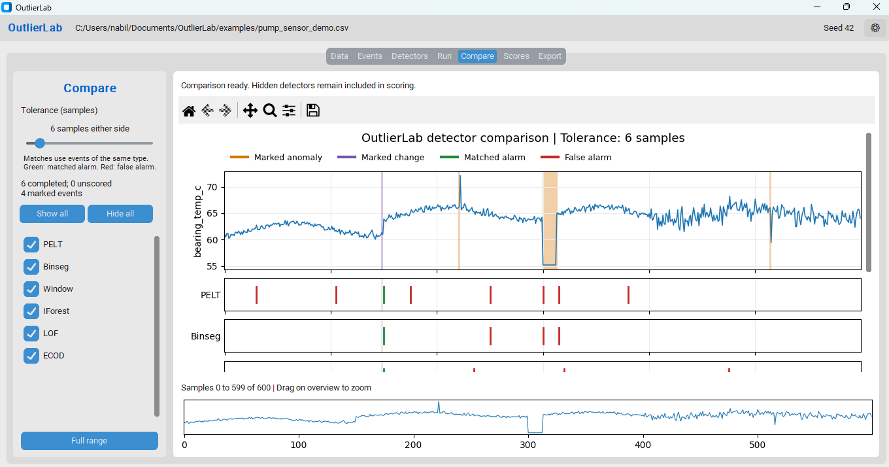
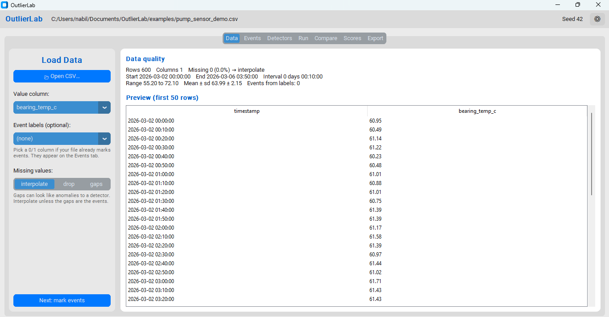
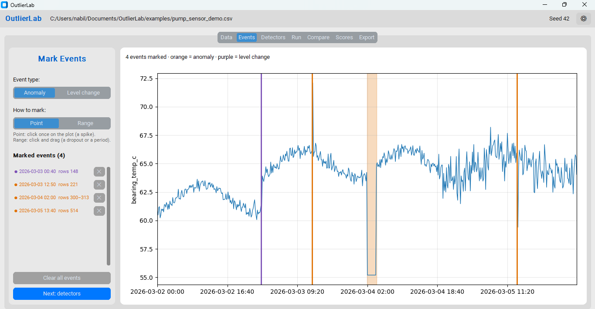
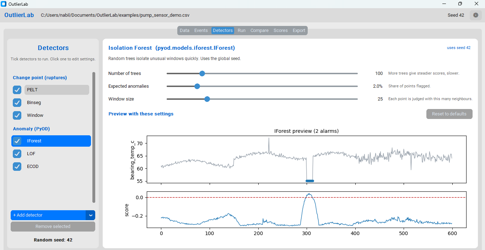
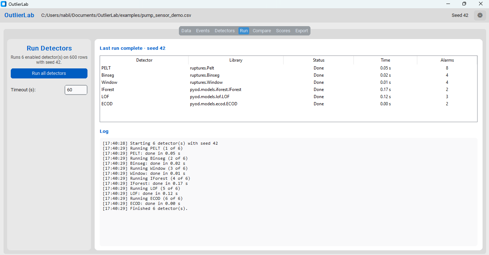
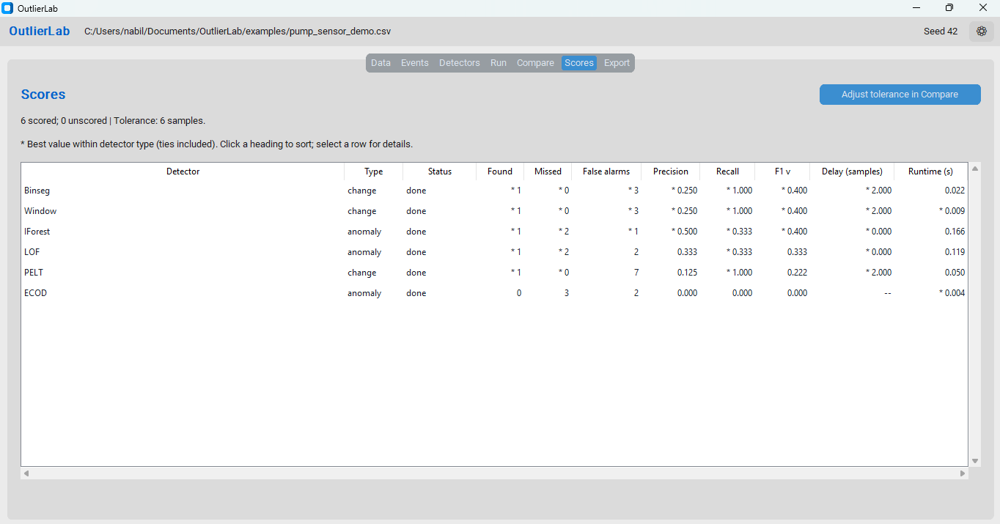
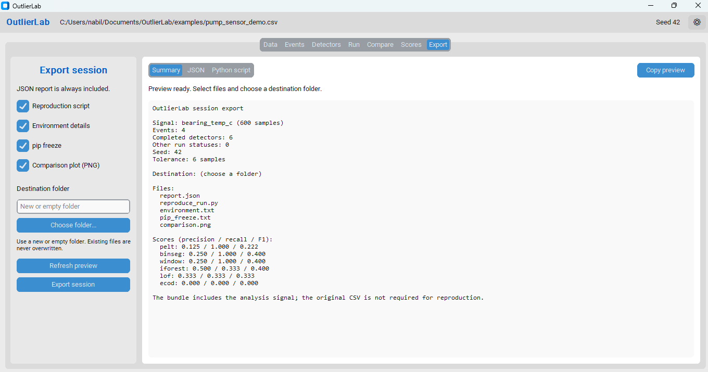

# OutlierLab


Offline desktop tool for comparing time-series anomaly and changepoint detectors side by side.

Load a CSV, mark the events you know about, run up to ten detectors on the same signal, and see which detector found which event, how fast, and with how many false alarms. Every run uses one random seed and can be exported with a script that reproduces the scores.



## Features

- **Ten detectors in one place:** five changepoint detectors from [ruptures](https://centre-borelli.github.io/ruptures-docs/) (PELT, Binary segmentation, Bottom-up, Sliding window, Kernel change detection) and five outlier detectors from [PyOD](https://pyod.readthedocs.io/) (Isolation Forest, Local Outlier Factor, k-Nearest Neighbours, ECOD, One-class SVM).
- **Your own ground truth:** click or drag on the plot to mark point and range events, or load them from a 0/1 label column.
- **Fair scoring:** alarms are matched to events within a tolerance you choose. The Scores tab reports found and missed events, false alarms, precision, recall, F1, mean delay and runtime.
- **Reproducible:** one seed for every random step. Export writes `report.json`, a `reproduce_run.py` script, the environment and pip freeze, and the comparison plot.
- **Works offline:** a desktop app built on CustomTkinter and Matplotlib. No server and no account.

## Install

Python 3.10 or newer.

**pip**

```bash
pip install outlierlab
```

To get the latest version from GitHub instead:

```bash
pip install git+https://github.com/NabilMezher/OutlierLab.git
```

**conda**

```bash
git clone https://github.com/NabilMezher/OutlierLab.git
cd OutlierLab
conda env create -f environment.yml
conda activate outlierlab
pip install -e . --no-deps
```

## Quick start

1. Start the app with `outlierlab` (or `python -m outlierlab`).
2. **Data:** click **Open CSV…** and choose `examples/pump_sensor_demo.csv`.
3. **Events:** click the spike near 3 March 13:00 to mark an anomaly. Switch to **Range** and drag over the dropout around 4 March 02:00.
4. **Detectors:** add a few detectors from **+ Add detector**, then **Run:** click **Run all detectors**.
5. **Compare** shows each detector's alarms under the signal (green = matched, red = false alarm). **Scores** ranks them, and **Export** saves the whole session.

The full walkthrough of all seven tabs is in the [user guide](docs/user-guide.md).

Click a screenshot to open that tab's section of the user guide.

| [1. Data](docs/user-guide.md#1-data) | [2. Events](docs/user-guide.md#2-events) | [3. Detectors](docs/user-guide.md#3-detectors) | [4. Run](docs/user-guide.md#4-run) |
|---|---|---|---|
| [](docs/user-guide.md#1-data) | [](docs/user-guide.md#2-events) | [](docs/user-guide.md#3-detectors) | [](docs/user-guide.md#4-run) |

| [5. Compare](docs/user-guide.md#5-compare) | [6. Scores](docs/user-guide.md#6-scores) | [7. Export](docs/user-guide.md#7-export) |
|---|---|---|
| [](docs/user-guide.md#5-compare) | [](docs/user-guide.md#6-scores) | [](docs/user-guide.md#7-export) |

## Use it without the GUI

The core works from plain Python, so you can script it or run it on a server:

```bash
python examples/run_headless_demo.py
```

See [examples/README.md](examples/README.md) for the example datasets: a synthetic pump sensor and the real NYC taxi series from the Numenta Anomaly Benchmark.

## Run the tests

```bash
pip install -e ".[dev]"
pytest --cov=outlierlab
```

CI runs the tests on Ubuntu and Windows with Python 3.10, 3.11 and 3.12, with both pip and conda.

## Documentation

- [User guide](docs/user-guide.md): every tab, step by step
- [Metrics](docs/metrics.md): how alarms are matched and scored
- [Compare](docs/compare.md), [Scores](docs/scores.md), [Export](docs/export.md), [Plotting](docs/plotting.md)
- [CHANGELOG](CHANGELOG.md)

## How to cite

If you use OutlierLab in your work, please cite it. GitHub shows a **Cite this repository** button built from [CITATION.cff](CITATION.cff).

DOI: added after the v1.0.0 release.

## Team

- Nabil Mezher (@nabilmezher): data loading, events, app shell, packaging and CI
- Sira Sayyour (@sirasayyour2006): detectors, runner, settings and examples
- Georges Levonian (@GeorgesxD21): metrics, plots, Compare, Scores and Export

## License

MIT. See [LICENSE](LICENSE).
