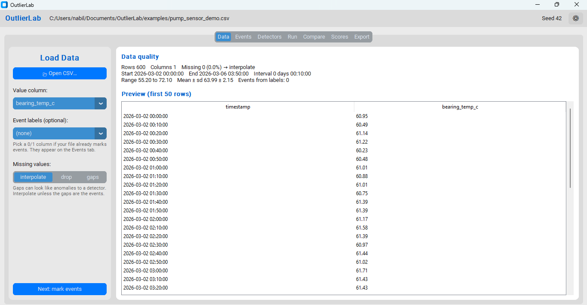
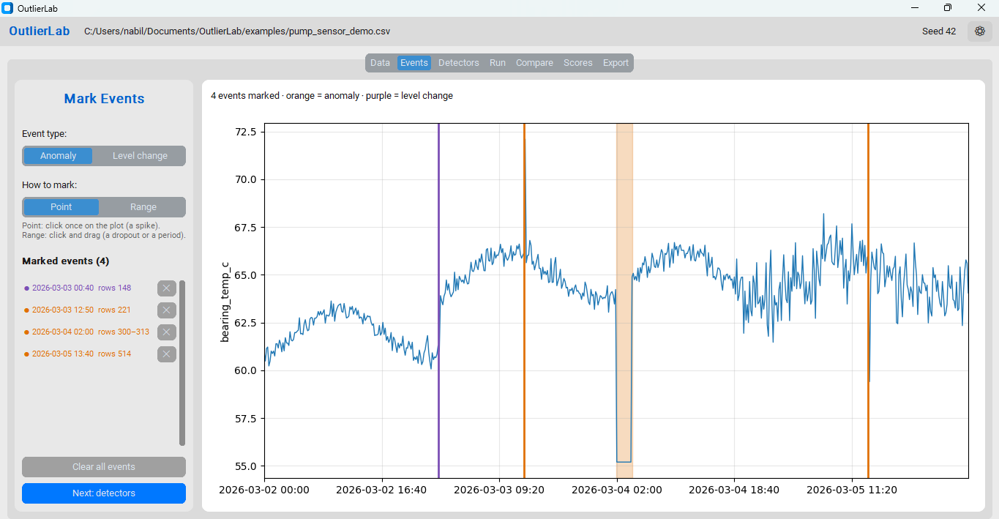
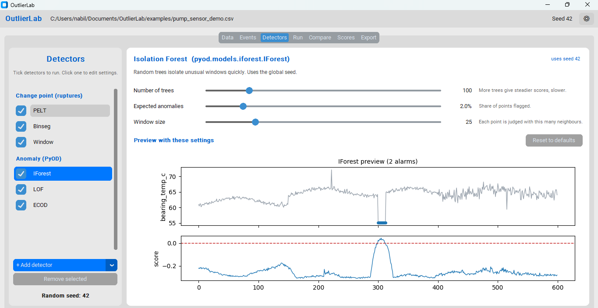
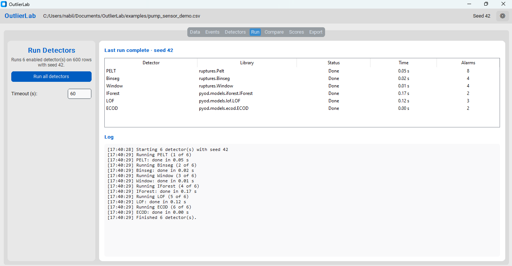
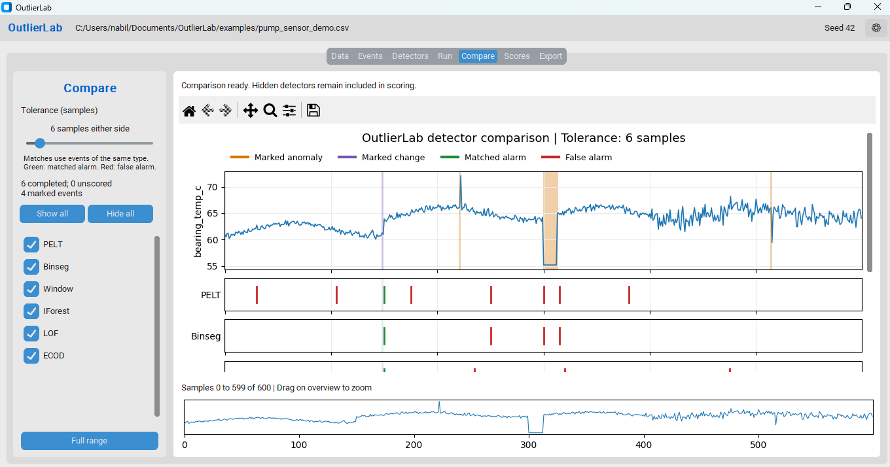
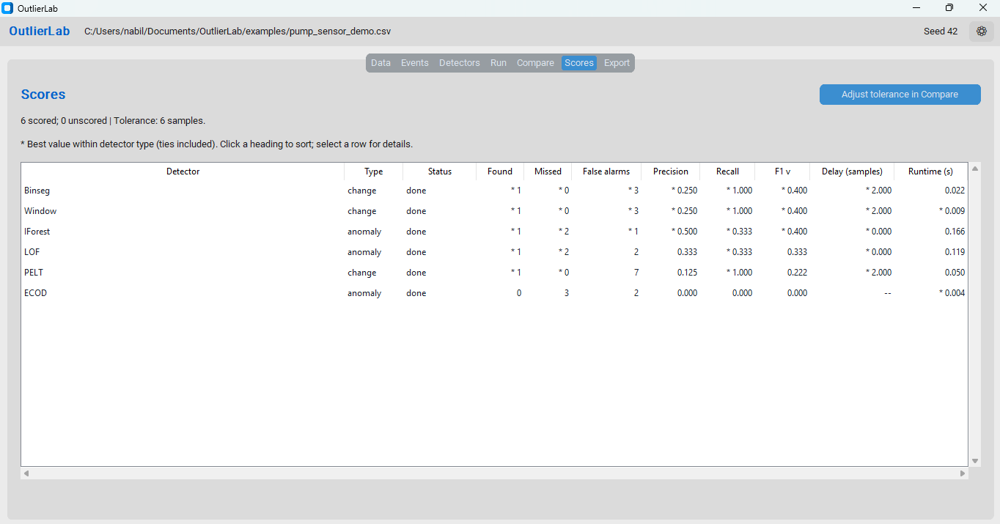
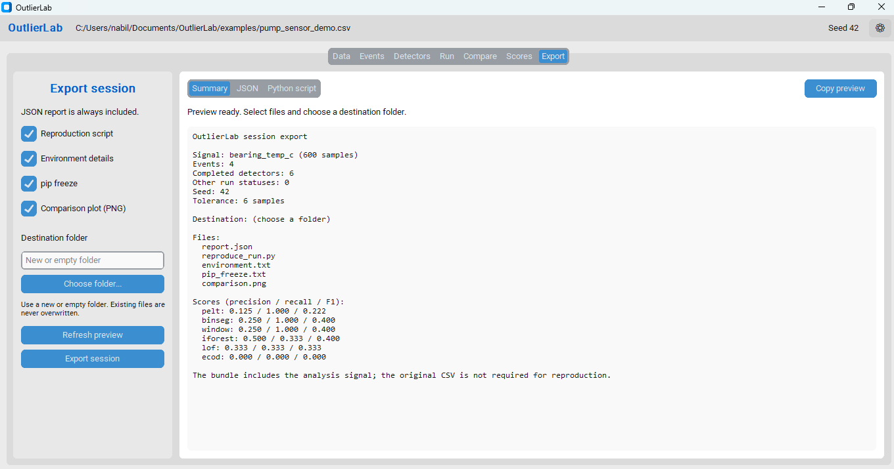

# OutlierLab user guide

This guide walks through the seven tabs in order. Each tab feeds the next one, so a normal session goes left to right:

**Data → Events → Detectors → Run → Compare → Scores → Export**

The header always shows the loaded file and the current random seed. The ⚙ button opens **Settings**.

To follow along, start the app with `outlierlab` and use `examples/pump_sensor_demo.csv`. It is a 600-row temperature series at 10-minute intervals, with a spike around row 222 and a dropout around rows 300 to 312.

---

## 1. Data

Load the time series you want to analyse.

1. Click **Open CSV…** and pick a file. OutlierLab finds the time column by itself and uses it as the time axis.
2. **Value column:** choose the column the detectors should run on.
3. **Event labels (optional):** if your file already has a 0/1 column that marks events, choose it here. The marked rows appear on the Events tab.
4. **Missing values:** choose how to treat gaps.
   - **interpolate** (default): fills each gap with a straight line between its neighbours. Use this unless the gaps are what you are looking for.
   - **drop**: removes the rows with missing values.
   - **gaps**: keeps the gaps, so they show as breaks in the plot.

The **Data quality** box shows the number of rows, the missing values, the time range, the sampling interval (with a warning if it is irregular), and the range and mean of the values. The table shows the first 50 rows.

If a file cannot be loaded, a message explains why, for example a missing time column or a value column that is not numeric.

> Changing the value column or the missing-value option clears old detector results, because they belong to the old signal.

## 2. Events

Mark the ground truth, the events you know really happened. Detectors are scored against these.

1. **Event type:** choose **Anomaly** for a one-off spike or outlier, or **Level change** for a lasting shift in the signal.
2. **How to mark:**
   - **Point:** click once on the plot.
   - **Range:** click and drag across a period.
3. The events appear in the **Marked events** list, colour-coded (orange = anomaly, purple = level change). Click **✕** to delete one, or **Clear all events** to start again.

Events cannot overlap. If you mark one on top of another, a red message explains why it was not added.

## 3. Detectors

Choose which detectors to compare and set their parameters.

1. Use **+ Add detector** to add detectors. There are ten:

   | Type | Detectors (library) |
   |---|---|
   | Level change | PELT, Binary segmentation, Bottom-up, Sliding window, Kernel change detection (ruptures) |
   | Anomaly | Isolation Forest, Local Outlier Factor, k-Nearest Neighbours, ECOD, One-class SVM (PyOD) |

2. Tick the detectors you want to run. Click one to edit its settings. Each slider explains what it does, for example "Higher penalty produces fewer change points".
3. The **Preview with these settings** plot under the sliders shows the detector's result live, so you can tune it before the full run.
4. **Reset to defaults** restores its settings, and **Remove selected** takes it off the list.

You can add the same detector twice with different settings to compare them.

## 4. Run

1. Set a **Timeout (s)** if you want slow detectors to stop after a while.
2. Click **Run all detectors**. They run in the background, so the window never freezes. The progress bar and **Log** show what is happening, and **Cancel** stops the run.

Every run uses the seed from Settings, so the same settings always give the same result.

## 5. Compare

See every detector's alarms under the signal, one row per detector.

- **Green** = an alarm that matched one of your events. **Red** = a false alarm.
- **Tolerance (samples):** how far an alarm may be from an event and still count as a match. Alarms only match events of the same type, so a level-change detector is scored on level changes and an anomaly detector on anomalies.
- **Show all / Hide all** and the detector checkboxes choose which rows to show.
- **Drag on the overview** strip to zoom in, and use **Full range** to zoom out. The toolbar can pan and save the figure.

## 6. Scores

One row per detector, with these columns:

| Column | Meaning | Better |
|---|---|---|
| Found | events the detector caught | higher |
| Missed | events it missed | lower |
| False alarms | alarms that match no event | lower |
| Precision | share of alarms that were real | higher |
| Recall | share of events that were found | higher |
| F1 | balance of precision and recall | higher |
| Delay (samples) | how late it caught events, on average | lower |
| Runtime (s) | how long it took | lower |

- Click a heading to sort. The best value in each column is marked with *, compared within the same detector type.
- Select a row for details, including why a run failed, timed out or was cancelled.
- **Adjust tolerance in Compare** takes you back to change the tolerance. The scores update automatically.

## 7. Export

Save the whole session so someone else can check it.

1. Wait for the preview. You can view it as **Summary**, **JSON** or **Python script**, and **Copy preview** copies it.
2. Choose what to include. `report.json` is always included, and you can add:
   - `reproduce_run.py`: a script that reruns the analysis and checks the scores
   - `environment.txt`: Python, OS and package versions
   - `pip_freeze.txt`: the exact packages installed
   - `comparison.png`: the Compare plot
3. Click **Choose folder…** and pick a new or empty folder. Existing files are never overwritten.
4. Click **Export session**.

To check the result later, open a terminal in that folder and run `python reproduce_run.py`. It reports whether the scores match.

## Settings (⚙)

- **Random seed:** one seed for every random step. Change it to check that a result does not depend on luck.
- **Theme:** system, light or dark.

## Tips

- If every detector raises too many false alarms, increase the tolerance in Compare or the penalty in Detectors.
- Mark only the events you are sure of. An event you forgot to mark makes correct alarms look like false ones.
- For a real dataset, try `examples/nyc_taxi.csv` (NYC taxi passengers, with the marathon, Thanksgiving, Christmas, New Year and a snowstorm as known events).
